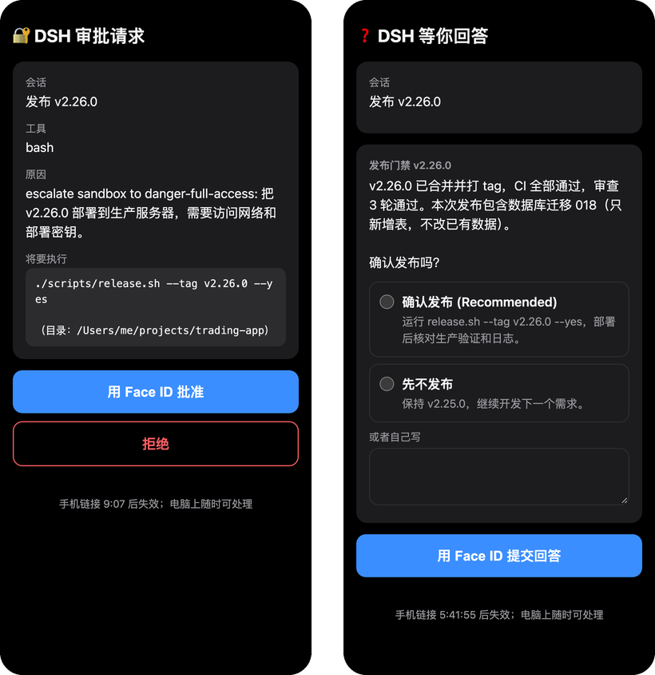

# dsh-phone-approval

DeepSeek Harness（DSH）插件。DSH 需要人工处理的事项（权限审批、agent 提问）会通过 [Bark](https://bark.day.app) 推送到 iPhone，并可以直接在手机上处理。批准和提交回答需要通过 Face ID 验证。

<p align="center">
  
</p>

## 功能

- **推送通知**：审批请求、agent 提问、对话完成、对话出错四类事件，可分别开关。默认只推送由你发起的对话的完成通知，后台子 agent、定时任务等自动触发的对话不推送。
- **手机审批**：审批通知附带一次性链接，页面显示会话、工具、审批原因和将要执行的命令。拒绝直接生效，批准需要 Face ID。
- **手机回答提问**：agent 通过 `ask_user_question` 提出的问题（包括计划审阅、发布确认）可以在手机上作答，提交需要 Face ID。
- **与电脑端并行**：电脑上的审批框和提问框照常弹出，以先处理的一方为准。在手机上处理后，电脑上的对话框会自动关闭。
- **加密推送**：可选的端到端加密（AES-256-CBC），Bark 服务器和 Apple 推送服务只能看到密文。
- **自建 Bark 服务器**：支持使用自己部署的 [bark-server](https://github.com/Finb/bark-server)。
- **设置页**：在 DSH 左侧边栏的「手机审批」中管理 Bark key、Tailscale 转发、Face ID、加密和推送选项。

## 运行要求

| 组件 | 要求 |
|---|---|
| DeepSeek Harness | 桌面版或 `dsh --profile web`。已在 0.2.2-rc.3 上验证 |
| 操作系统 | macOS。Linux 理论上可以运行，未经验证 |
| iPhone | iOS 16 及以上，安装 Bark 和 Tailscale |
| Tailscale | Mac 和 iPhone 登录同一个 tailnet，在管理后台开启 MagicDNS 和 HTTPS 证书 |
| Docker | 仅在自建 bark-server 时需要 |

只使用推送通知、不在手机上处理时，不需要 Tailscale。

## 快速开始

1. 克隆仓库：

   ```sh
   git clone https://github.com/Kuner/dsh-phone-approval.git
   ```

2. 在 DSH 中打开 **插件** → **添加插件** → **安装第三方插件**，输入克隆目录的完整路径。
3. 完全退出 DSH（⌘Q）后重新打开。
4. 打开左侧边栏的 **手机审批**，保存 Bark key，并开启 HTTPS 转发。
5. 收到第一条审批通知后，打开链接，按页面提示注册 Face ID。

完整步骤见[用户手册](docs/user-guide.md)。

## 文档

| 文档 | 内容 |
|---|---|
| [用户手册](docs/user-guide.md) | 安装、首次配置、日常使用、故障排查、卸载 |
| [配置参考](docs/configuration.md) | 全部配置项、凭据记录、端口 |
| [安全说明](docs/security.md) | 认证方式、网络暴露面、数据流向、已知限制 |
| [开发说明](docs/development.md) | 架构、模块划分、使用的 DSH 扩展点、测试 |
| [更新记录](CHANGELOG.md) | 版本变更 |

## 工作方式

插件运行在 DSH 主进程中，并在本机监听两个端口：

- `127.0.0.1:47391`：手机审批页。通过 `tailscale serve` 以 HTTPS 发布到 tailnet，不暴露到公网。
- `127.0.0.1:47392`：设置页使用的管理接口，只在本机可访问，需要令牌。

审批请求到达时，插件先生成一次性链接并发出推送，再把请求交给 DSH 自带的审批框。手机和电脑同时等待，先给出决定的一方生效。详见[开发说明](docs/development.md)。

## 已知限制

- DSH 的审批只有“允许一次”和“拒绝”，没有“始终允许”。
- 手机端处理依赖 Tailscale。Mac 上的 Tailscale 断开时，通知照常发送，但只能在电脑上处理。
- DSH 重启后，尚未处理的手机链接全部失效。
- 手机处理后电脑端对话框自动关闭，这一点依赖 DSH 内部的请求转发行为。升级 DSH 后请重新验证。
- 第一次注册 Face ID 时，服务端无法分辨注册者是不是你本人，以第一个完成注册的设备为准。参见[安全说明](docs/security.md#首次注册)。

## 许可证

[MIT](LICENSE)
