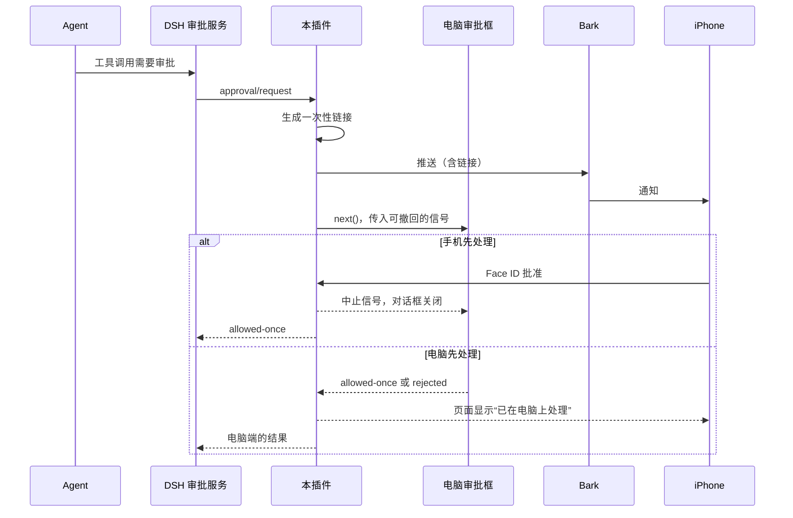

# 开发说明

## 架构

插件分为两部分：

- **Host 部分**（`index.js` 及其引用的模块）：运行在 DSH 主进程中。负责监听会话事件、接入审批和提问流程、发送推送，并运行两个本机 HTTP 服务。
- **Client 部分**（`client.js`）：运行在 DSH 页面中。负责注册左侧边栏入口和设置页。

### 审批流程



插件以 `prepend` 方式注册 `approval/request` 监听器，位于 DSH 自带的转发器之前。插件自己不给出结果，而是在调用 `next()` 之前把请求上的 `signal` 替换为 `AbortSignal.any([原信号, 插件信号])`。DSH 的 API 网关转发请求时会读取这个信号，信号中止时撤回电脑端的对话框。

电脑端返回 `unavailable`（没有打开的 DSH 页面）时，插件继续等待手机，直到链接过期。

`user-questions/request` 的处理方式相同。区别在于，计时提问超时后，工具调用会返回“待回答”结果，但手机链接保留。之后在手机上提交的回答，通过 `ctx.userQuestions.answer()` 作为补充回复发给 agent。

### 通知

通知由 `session/event` 的观察者生成，只读取已提交的事件，不影响任何结果：

| 事件 | 用途 |
|---|---|
| `turn/start`、`turn/end` | 计算对话时长，判断是否推送完成或出错 |
| `user/message` | 根据消息来源（`user`、`user-question-reply`）判断对话是否由人发起 |
| `assistant/message` | 记录最后一段回复，作为完成通知的正文 |
| `tool/call` | 记录最近 30 个工具调用的参数，供审批页显示命令 |
| `approval/asked` | 未启用手机审批时，发送不带链接的审批通知 |

启用手机审批时，审批和提问通知由上面的监听器统一发送，确保每个请求只推送一次。DSH 启动或插件重新加载后，审批页地址需要等 Tailscale 检查完成才能确定，这段时间内到达的请求最多等待 `readyTimeoutMs`。

### 使用的 DSH 扩展点

| 扩展点 | 用途 |
|---|---|
| `session/event`、`session/disposed` | 通知和会话状态 |
| `approval/request`（waterfall） | 手机审批 |
| `user-questions/request`（waterfall） | 手机回答 |
| `ctx.userQuestions.answer()` | 回答已转为“待回答”的提问 |
| `ctx.credentials` | Bark key、通行密钥、加密密钥的读写 |
| `ctx.configEditor` | 设置页保存配置 |
| `ctx.sessionTitle` | 通知标题中的会话名 |
| `webserver/index-inject` | 向 owner 页面注入管理接口地址和令牌 |
| Client `sidebar.panellist`、`main` slot | 左侧边栏入口和设置页 |

以上接口基于 DSH 0.2.2-rc.3 的源码确认。电脑端对话框自动关闭依赖的 `request.signal` 读取行为不是公开接口，升级 DSH 后需要重新验证。

## 模块

| 文件 | 内容 |
|---|---|
| `index.js` | Host 插件入口：配置、通知、审批和提问监听、管理接口路由、页面注入 |
| `phone-approval.js` | 审批页 HTTP 服务、链接生命周期、通行密钥注册与校验、回答校验 |
| `webauthn.js` | CBOR 解码与 WebAuthn 注册、断言校验，无第三方依赖 |
| `bark-crypto.js` | Bark 推送加密（AES-256-CBC） |
| `page.js` | 手机页面（审批和提问共用）的 HTML、CSS、脚本 |
| `admin.js` | 设置页使用的本机管理接口 |
| `tailscale.js` | Tailscale 状态查询和 `tailscale serve` |
| `client.js` | 设置页和左侧边栏入口（React，通过 DSH 的模块加载器加载） |
| `cordis.patch.yml` | 安装时插入 DSH profile 的插件行 |
| `locale/` | 插件列表中显示的名称和说明 |

插件不依赖任何 npm 包，`package.json` 中没有 `dependencies`。

## 测试

需要 Node.js 20 及以上。

```sh
npm run check   # 语法检查
npm test        # 端到端测试和设置页测试
```

- `test/e2e.mjs`：模拟 DSH 上下文，用软件实现的 WebAuthn 认证器覆盖注册、批准、拒绝、回答、电脑先处理、取消、过期、加密推送、消息过滤、启动时序等场景。Bark 请求会被拦截，不会真正发出。
- `test/client-smoke.mjs`：用简化的 React 实现加载 `client.js`，检查注册项和各状态下的渲染，并检查每个组件在不同渲染中调用的 hook 数量一致（React 的 hook 规则）。

每次推送到 `main` 和每个 PR 都会由 GitHub Actions 在 Node.js 20 和 22 上运行上述两条命令，配置见 `.github/workflows/test.yml`。

测试会占用本机端口 47396–47399。其中一个用例会调用本机的 `tailscale` 命令；没有安装 Tailscale 时，该用例的结果不受影响。

## 截图

`docs/images/` 中的截图由 `tools/screenshots/` 生成：用插件真实的 `page.js` 和 `client.js`、DSH 的主题样式和示例数据渲染页面，再用 headless Chrome 截图。生成方法见 [tools/screenshots/README.md](../tools/screenshots/README.md)。

## 发布

1. 更新 `package.json` 的 `version` 和 [CHANGELOG.md](../CHANGELOG.md)。
2. 运行 `npm test`。
3. 改动涉及界面时，重新生成截图。
4. 提交并推送。本机通过链接方式安装的插件，在 DSH 重启后加载新代码。
