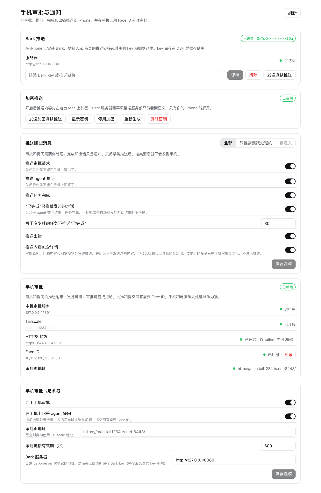
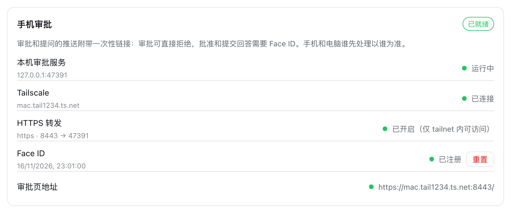
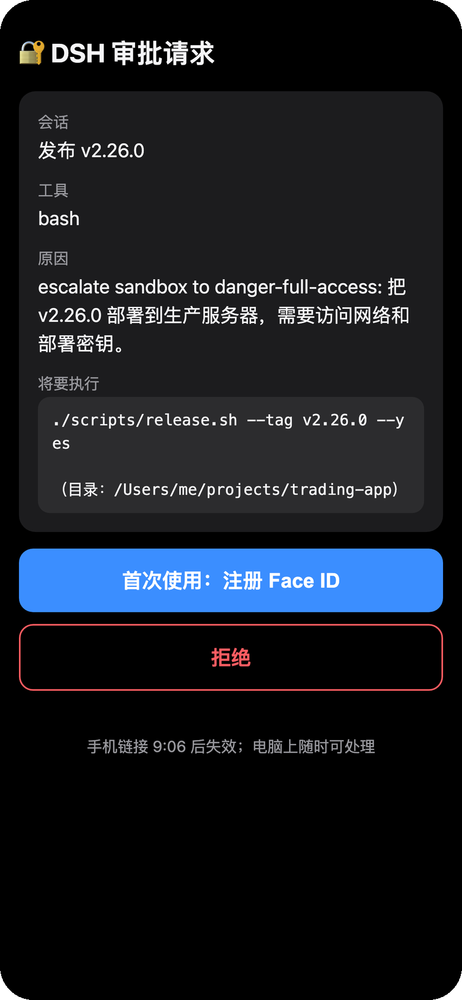
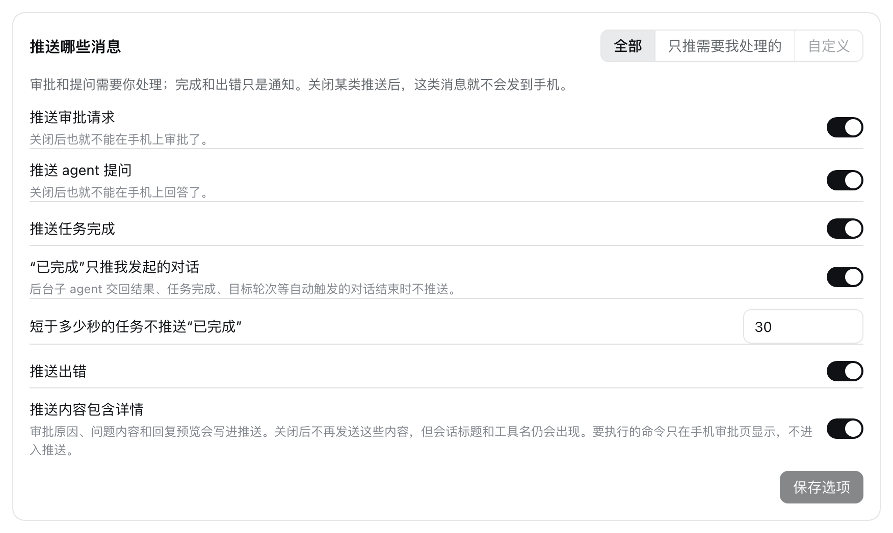
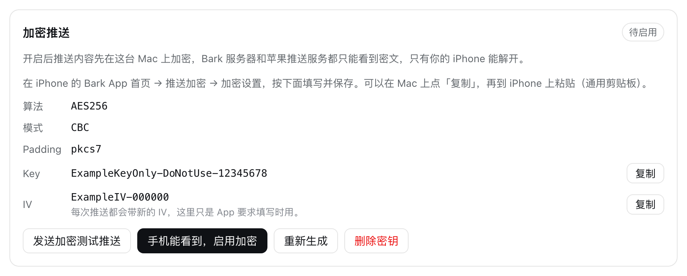
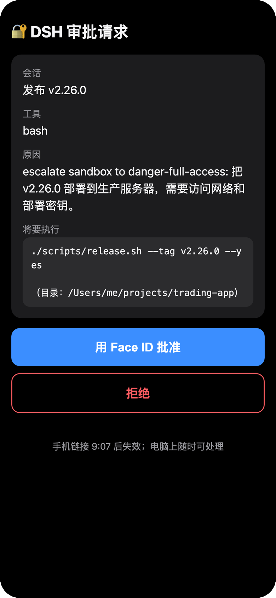
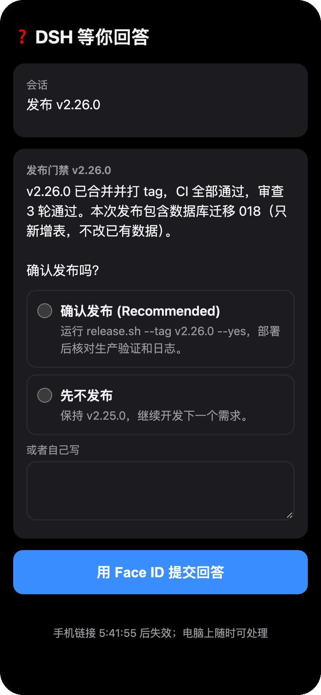

# 用户手册

本手册介绍 dsh-phone-approval 的安装、首次配置和日常使用。配置项的完整说明见[配置参考](configuration.md)。

- [1. 准备工作](#1-准备工作)
- [2. 安装插件](#2-安装插件)
- [3. 首次配置](#3-首次配置)
- [4. 日常使用](#4-日常使用)
- [5. 故障排查](#5-故障排查)
- [6. 更换手机或重置](#6-更换手机或重置)
- [7. 卸载](#7-卸载)

## 1. 准备工作

**iPhone**

- 安装 [Bark](https://bark.day.app)（App Store 搜索 Bark）。
- 安装 [Tailscale](https://tailscale.com)，用与 Mac 相同的账号登录。
- 在 **设置 → 通知 → Bark** 中开启“时效性通知”。审批和提问使用这一级别推送，开启后在专注模式下也能收到。

**Mac**

- 安装并登录 Tailscale。
- 在 [Tailscale 管理后台](https://login.tailscale.com/admin/dns) 开启 **MagicDNS** 和 **HTTPS Certificates**。手机审批页需要 HTTPS，Face ID 也只能在 HTTPS 页面中使用。

如果只需要推送通知，可以跳过 Tailscale 的相关步骤。

## 2. 安装插件

1. 克隆仓库到本地，例如 `~/Projects/dsh-phone-approval`。
2. 在 DSH 中打开 **插件** → **添加插件** → **安装第三方插件**，输入该目录的完整路径并确认。
3. 完全退出 DSH（⌘Q）后重新打开。

   设置页通过页面加载时注入的令牌连接插件后台，因此安装后必须重启一次。

安装完成后，左侧边栏会出现 **手机审批** 入口。

> 插件以链接方式安装，DSH 直接读取克隆目录中的文件。更新插件时，在该目录执行 `git pull`，然后重启 DSH。不要先卸载再重装：卸载和重装之间产生的审批请求不会有推送。

## 3. 首次配置

打开左侧边栏的 **手机审批**。页面分为五个部分，下面按配置顺序说明。

<picture>
  <source media="(prefers-color-scheme: dark)" srcset="images/settings-dark.png">
  
</picture>

### 3.1 Bark 推送

1. 打开 iPhone 上的 Bark，复制首页的推送链接，例如 `https://api.day.app/AbCdEf123456/这里改成你自己的推送内容`。
2. 粘贴到 **Bark 推送** 的输入框，点击 **保存**。可以粘贴整个链接，插件会从中取出 key；也可以只粘贴 key。
3. 点击 **发送测试推送**，确认手机收到通知。

key 保存在 DSH 的凭据存储（`~/.dsh/.credentials.yaml`）中，页面上只显示打码后的值。

**服务器** 一行显示当前 Bark 服务器能否访问。默认使用公共服务器 `https://api.day.app`，自建方式见 [3.6](#36-自建-bark-服务器可选)。

### 3.2 HTTPS 转发



**手机审批** 部分列出了在手机上处理所需的各项条件：

| 项目 | 正常状态 | 处理方法 |
|---|---|---|
| 本机审批服务 | 运行中 | 显示“未运行”时，确认端口 47391 没有被占用，然后重启 DSH |
| Tailscale | 已连接 | 在菜单栏打开 Tailscale 并连接 |
| HTTPS 转发 | 已开启（仅 tailnet 内可访问） | 点击 **开启** |
| Face ID | 已注册 | 第一次在手机上批准时注册，见 [3.3](#33-注册-face-id) |
| 审批页地址 | `https://<Mac 的名称>.<tailnet>.ts.net:8443/` | 自动生成，不需要填写 |

点击 **开启** 等同于执行以下命令：

```sh
tailscale serve --bg --https=8443 http://127.0.0.1:47391
```

这条转发只对你的 tailnet 开放，不会暴露到公网。各项都正常后，右上角显示 **已就绪**。

### 3.3 注册 Face ID

Face ID 不在设置页中注册，而是在第一次收到审批通知时完成：

1. 点开审批通知，Safari 打开审批页。
2. 页面底部显示 **首次使用：注册 Face ID**。点击后按系统提示完成验证。
3. 注册成功后，按钮变为 **用 Face ID 批准**。



注册生成的是一个通行密钥（passkey），与审批页的域名绑定，私钥保存在 iPhone 上，插件只保存公钥。同一时间只能注册一个设备，更换设备见[第 6 节](#6-更换手机或重置)。

### 3.4 选择推送哪些消息



右上角提供两个预设：

- **全部**：四类事件都推送。
- **只推需要我处理的**：只推送审批请求和 agent 提问。

也可以逐项设置：

| 选项 | 说明 |
|---|---|
| 推送审批请求 | 关闭后，审批请求既不推送，也不能在手机上处理 |
| 推送 agent 提问 | 关闭后，提问既不推送，也不能在手机上回答 |
| 推送任务完成 | 一轮对话正常结束时推送，正文是回复的开头 |
| “已完成”只推我发起的对话 | 默认开启。后台子 agent 交回结果、后台任务完成、目标轮次、定时提醒等自动开始的对话，结束时不推送 |
| 短于多少秒的任务不推送“已完成” | 用于过滤很快结束的对话，0 表示不过滤 |
| 推送出错 | 一轮对话因错误中止时推送，正文是错误信息 |
| 推送内容包含详情 | 关闭后，推送中不再包含审批原因、问题内容和回复预览，但会话标题和工具名仍会出现 |

修改后点击 **保存选项**。保存时插件会按新配置重新加载，耗时约一秒。

### 3.5 加密推送（可选）

开启后，推送内容在 Mac 上加密，Bark 服务器和 Apple 推送服务只能看到密文，由 iPhone 上的 Bark 解密后显示。



1. 点击 **生成密钥**。页面显示算法、模式、Key 和 IV。
2. 在 iPhone 的 Bark 中打开 **推送加密 → 加密设置**，填写：
   - 算法：`AES256`
   - 模式：`CBC`
   - Padding：`pkcs7`
   - Key、IV：与页面上显示的一致。Mac 和 iPhone 开启了通用剪贴板时，可以在 Mac 上点击 **复制**，再到 iPhone 上粘贴。
3. 回到设置页，点击 **发送加密测试推送**。
4. 手机能正常显示内容时，点击 **手机能看到，启用加密**。如果显示 `Decryption Failed`，说明 Key 或算法填写有误。

新生成的密钥默认不启用，在第 4 步之前推送仍是明文，因此填写过程中不会漏收通知。每条推送都会使用新的随机 IV，页面上的 IV 只用于填写 App 中的必填项。

如果重新生成密钥，需要在手机上同步更新，否则通知会显示 `Decryption Failed`。

### 3.6 自建 Bark 服务器（可选）

默认的公共服务器由 Bark 作者运营。不开启加密时，推送内容会经过该服务器。自建服务器后，推送只经过你自己的机器和 Apple 推送服务。

在 Mac 上运行 bark-server，并通过 Tailscale 发布，供 iPhone 注册设备：

```sh
docker run -d --name bark --restart unless-stopped \
  -p 127.0.0.1:8080:8080 -v ~/.bark-server/data:/data finab/bark-server
tailscale serve --bg --https=8444 http://127.0.0.1:8080
```

然后按顺序完成：

1. 在 iPhone 上连接 Tailscale，在 Bark 的服务器列表中添加 `https://<Mac 的名称>.<tailnet>.ts.net:8444`。添加后 Bark 会为这个服务器生成一个新的 key。
2. 在设置页的 **手机审批与服务器** 中，把 **Bark 服务器** 改为 `http://127.0.0.1:8080`，点击 **保存选项**。插件与服务器在同一台机器上，直接访问本机地址。
3. 在 **Bark 推送** 中保存新的 key，然后发送测试推送。

每个服务器的 key 互不通用。换服务器后如果不更新 key，推送会返回 HTTP 400。

bark-server 依赖 Docker Desktop 运行。建议在 Docker Desktop 中开启“登录时启动”，否则重启后推送会失败，设置页的 **服务器** 一行会显示“连不上”。

## 4. 日常使用

### 4.1 通知类型

| 标题 | 触发条件 | iOS 通知级别 | 点开后 |
|---|---|---|---|
| `🔐 需要审批：<会话标题>` | agent 的操作需要审批，包括子 agent 发起的审批 | 时效性 | 手机审批页 |
| `❓ 等待你回答：<会话标题>` | agent 调用 `ask_user_question` | 时效性 | 手机回答页 |
| `✅ 已完成：<会话标题>` | 一轮对话正常结束 | 普通 | 无 |
| `⚠️ 出错：<会话标题>` | 一轮对话因错误中止 | 时效性 | 无 |

你手动停止的对话不会推送，子 agent 的完成和出错也不会推送。

### 4.2 在手机上审批



审批页显示：

- **会话**：发起审批的会话标题。
- **工具**：需要审批的工具，例如 `bash`、`plugin_manager`。
- **原因**：agent 给出的申请理由。
- **将要执行**：工具调用的完整参数，`bash` 显示命令和工作目录。这部分只在审批页显示，不会写进推送。

**拒绝** 直接生效，不需要验证。**用 Face ID 批准** 需要通过 Face ID，验证成功后页面显示“已批准”。

### 4.3 在手机上回答提问



页面显示问题全文和每个选项的说明。单选题选择一个选项，或在“或者自己写”中输入回答，两者只能取其一。多选题可以同时选择多个选项并附加说明。一次提问包含多个问题时，需要全部回答后统一提交。

提交需要 Face ID，因为“确认发布”这类回答本身就是一次授权。

如果电脑上的提问等待超时，问题会转为“待回答”，agent 继续做其他工作。此时手机上的链接仍然有效，提交的回答会作为补充回复发给 agent。

### 4.4 手机和电脑同时在线

推送发出后，电脑上的审批框或提问框照常显示：

- 先在手机上处理：电脑上的对话框自动关闭。
- 先在电脑上处理：手机页面显示“已在电脑上处理”，链接失效。
- 对话被中止：手机页面显示“请求已被取消”。

### 4.5 链接有效期

| 类型 | 默认有效期 | 修改方式 |
|---|---|---|
| 审批链接 | 10 分钟 | 设置页“审批链接有效期”，60–3600 秒 |
| 提问链接 | 6 小时 | 配置项 `phoneApproval.questionTtlSeconds` |

以下情况链接会提前失效：

- 已经处理过。
- 连续 5 次 Face ID 验证失败。
- DSH 重启。

链接失效后，电脑上的对话框仍可正常使用。

## 5. 故障排查

| 现象 | 原因 | 处理 |
|---|---|---|
| 设置页显示“无法连接插件后台” | 安装或更新插件后没有重启 DSH | 完全退出 DSH（⌘Q）后重新打开 |
| 测试推送提示“还没有设置 Bark key” | 没有保存 key | 按 [3.1](#31-bark-推送) 保存 key |
| 测试推送提示 `Bark 返回 HTTP 400` | key 与当前服务器不匹配，常见于更换服务器之后 | 在 Bark 中复制当前服务器对应的 key 并重新保存 |
| 服务器一行显示“连不上” | 自建 bark-server 没有运行 | 启动 Docker Desktop，执行 `docker start bark` |
| 审批通知中没有链接 | Mac 上的 Tailscale 未连接，或 HTTPS 转发未开启 | 检查设置页的 Tailscale 和 HTTPS 转发两项 |
| 手机页面显示“无法连接到电脑” | iPhone 上的 Tailscale 未连接 | 在 iPhone 上打开 Tailscale |
| 手机页面显示“链接无效或已失效” | 链接已过期、已处理，或 DSH 重启过 | 回到电脑上处理 |
| 换手机后点击批准，系统提示没有可用的通行密钥 | 已注册的是旧手机 | 见[第 6 节](#6-更换手机或重置) |
| Face ID 一行显示“绑定的是另一个地址” | Mac 的名称或审批页地址变了，原有通行密钥不再适用 | 下次审批时重新注册 |
| 通知显示 `Decryption Failed` | 手机上的加密设置与插件不一致 | 重新填写 Key 和算法，或在设置页停用加密 |
| 专注模式下收不到审批通知 | 时效性通知未开启 | iPhone **设置 → 通知 → Bark** 中开启“时效性通知” |
| 手机已处理，电脑上的对话框没有关闭 | DSH 版本变化导致关闭机制失效 | 在电脑上手动关闭，并[提交 issue](https://github.com/Kuner/dsh-phone-approval/issues)，注明 DSH 版本 |

## 6. 更换手机或重置

1. 在设置页 **手机审批** 部分的 Face ID 一行点击 **重置**。
2. 在新手机上安装 Bark 和 Tailscale，在 Bark 中复制新的 key，到设置页重新保存。如果开启了加密推送，还要在新手机上填写相同的 Key 和 IV。
3. 下一次审批时，在新手机上注册 Face ID。

## 7. 卸载

1. 在 DSH 中打开 **插件** → **手机审批与通知** → **卸载**，然后重启 DSH。
2. 关闭 Tailscale 转发：

   ```sh
   tailscale serve --https=8443 off
   ```

3. 如需清除凭据，编辑 `~/.dsh/.credentials.yaml`：删除 `refs` 下的 `DSH_BARK_KEY`，以及 `records` 下的 `phone-approval/passkey` 和 `phone-approval/bark-encryption`。
4. 如果自建了 bark-server：

   ```sh
   docker rm -f bark
   tailscale serve --https=8444 off
   rm -rf ~/.bark-server
   ```
